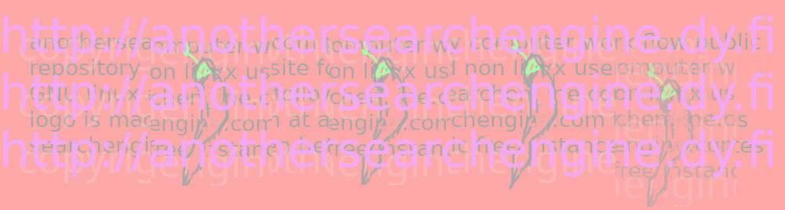

    
# CrackMes_safetyplace_when_disk_quota_expected...
<b>Will trying to save CrackMes directory to DropBOX OR EVEN PROTON DRIVE FOR PUBLIC INSTANCE AVAILABLE</b>
CrackMes_safetyplace_when_disk_quota_expected... Anothersearchengine CrackMes for blackhat hackers and crackers some files in nutshell... I could prinit lastly modified for every file this project includes and save it to the statics.dump file and download it to @ of repository to be with README.md that uses logo_envariables.jpg that also contains the file is Digital Fortress called maintain book process that works on manual to do lists, where CPU cant to act and it is impossible to CPU to give works like this one DigitalNeurons.exe file gives, by hiding it EIP and giving environment_variables thats malloc in dictionary travelsal attack used, the block called modsecurity disables the data cable to use for file transfer to attemp variables to get data slot to be filled with whole_exe_file_and_saved_as_behind_quarantine the sandbox of manual hacking to the filter.php TRANSTRL machine that uses 128 threads after one run... It md5 hash decodes in 15minutes for 9 charachers long mixedalpha-numeric 6-8, that could point from crunch to make wordlists.txt on localhost usage only that this project as made for educational purpoises only was limited... When TRANSLTR is biten the one thread over 15minutes, the file will be released on manually reverse_engineering to get or thrown back to quarantine as not to be in test level parameter set to yes... QUARANTINE CONTAINS FOLDERS TO CHECKSUM AND GIVEN FREE MOMENT TO CHOICHE ANYTHING TO DO AND EVEN CHANGE PC TO SOMETHING ELSE AND TAKE THE
holydays from the computer stuff to give the firejail for the file that takes too much time and embedded the nanomites to the slot location tray to give no-load current days for the files that have has the difficulty level to have seen best as 15 minutes if no effect by cracking the possible false positive to use the file for build the MainKeyChains.jpg to contain 4 pices of different coloured keys_ and everyone is correlated to be in place to fill in upload given option at page saying the SlotKeyGreen.jpg for example is for green topic releated web page that asks KeyFileGreen.jpg to open the locks.

Also this is important: If you need an poker-web-sites and casino sites finnish email-list starting at 80k of email addresses valid and not released in the internet before...

Also i have 80k finnish phone numbers database not used to anywhere these sql.dumps...

Ask screenshot and template of the list data to get full sql.dump

Also the passwords are shown in plaintext format and file contains 80k finnish poker and casino sites data..

Not sharen after this for made an offer of the price and the cryptocoin currency to be used, i accept monero, litecoin and bitcoin currently...

And i dont take nosensed price of database dumps relevating do you need only the email-addresses or the phonenumbers too and lastly the plaintext passwords in scoped to usernames that is 80k in database..

If you want to get the information data branch and pay something like 300 between 600 as currency of euros to converted as btc, xmr or ltc at endpoint to made the crypto transfer for my blockchain address...

To get my email addresses, you need to read the exifdata from logo_var.jpg file, that is encoded to base64 format for start...

Making Silence time to get some sleepp too   

