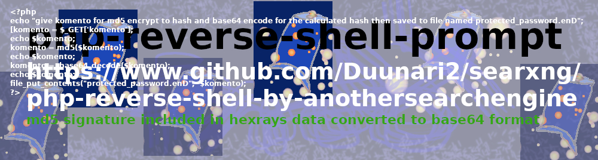
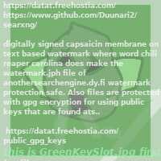

Currently CRACMES FOLDER ARE UNAVAILABLE AND TO BE REACHED BEHIND RADIO SILENCE LOCALHOST NETWORK USAGE ONLY, BECUSE I DONT HAVE DISK SPACE LEFT ON MY VIRTTUAL MACHINES AND IT WILL BE RELEASED AS FULL IMAGE OF PUZZLE WHERE ALL TRAYSLOTS ARE FILLEN WITH MAGICK BYTES--Connecting the number order to be usagen for build public application that have easily every file after clean of database from black energy that injected on CrackMES CReation to allow run payloads in trayslots where data should be embedded, but the programs one of them are using nanomites and every time the EIP is in different location than program start on debugger... The main quest is to get all plaintext data reached out from crackmes with containing image files and other mimetype files and then released as rainbow colour effect usable image shown the plaintext data etc... Only newbie protection i will set is md5 hash i will publish on root of the page for CrackMes, the cracked md5 hash will point you to the plaintext cracked data slottery...

I need to do some security checks, because i am close to give you the md5 hash to encrypt with bruteforcing method i guess... I allso try upload files that does not reach the 2mB FILELIMIT TO GET ONE SAVE DATA POINT TO BE REACHED...

yOURS SINCERELY,
tmS

https://datat.freehostia.com/ level 7 anti-ddos-protection without redirect build yet. Did only make the key, and lock, but not the data to extracted yet. I have many architecture structures in my ssd-flash drive and could give one WRITEUP.TXT for cracking base64 encoded md5 hash given in plaintext form. It is really easy password and takes maxium setup an one day to get the cracked values...

I keep red string on my hands and equip the secret services like temperature to be one of my collapse reindeers...¨

Just need to make clean to WriteUp1.txt after it available on http submit form that will be added on my webserver to be part 2 of md5 checksum detector..

Keep in mind that the my style have has allways contain steganographic encrypted data to embedd to image files behind password, so logo_var.jpg and logo.jpg are on active state to braking my nutshell to see one hex ray to one for the bigger image of the full jigsaw puzzle image that would be endpoint, and make me to change the missions i give my self maybe be in radio silence month for first etc...

Timestamp: ke 25.11.EET 2026 08.45.18 +0200

I let the email addresses to change for cryptos given spot to be not in any of encoded or encrypted format... I can select my customers without using computer blocks, just by asking few questions, like where these emails are to be used for... That could be end of one of these READPASS.md files containing district 900 data to give it people need it because dont have customers....

    
# CrackMes_safetyplace_when_disk_quota_expected...
<b>Will trying to save CrackMes directory to DropBOX OR EVEN PROTON DRIVE FOR PUBLIC INSTANCE AVAILABLE</b>
CrackMes_safetyplace_when_disk_quota_expected... Anothersearchengine CrackMes for blackhat hackers and crackers some files in nutshell... I could prinit lastly modified for every file this project includes and save it to the statics.dump file and download it to @ of repository to be with README.md that uses logo_envariables.jpg that also contains the file is Digital Fortress called maintain book process that works on manual to do lists, where CPU cant to act and it is impossible to CPU to give works like this one DigitalNeurons.exe file gives, by hiding it EIP and giving environment_variables thats malloc in dictionary travelsal attack used, the block called modsecurity disables the data cable to use for file transfer to attemp variables to get data slot to be filled with whole_exe_file_and_saved_as_behind_quarantine the sandbox of manual hacking to the filter.php TRANSTRL machine that uses 128 threads after one run... It md5 hash decodes in 15minutes for 9 charachers long mixedalpha-numeric 6-8, that could point from crunch to make wordlists.txt on localhost usage only that this project as made for educational purpoises only was limited... When TRANSLTR is biten the one thread over 15minutes, the file will be released on manually reverse_engineering to get or thrown back to quarantine as not to be in test level parameter set to yes... QUARANTINE CONTAINS FOLDERS TO CHECKSUM AND GIVEN FREE MOMENT TO CHOICHE ANYTHING TO DO AND EVEN CHANGE PC TO SOMETHING ELSE AND TAKE THE
holydays from the computer stuff to give the firejail for the file that takes too much time and embedded the nanomites to the slot location tray to give no-load current days for the files that have has the difficulty level to have seen best as 15 minutes if no effect by cracking the possible false positive to use the file for build the MainKeyChains.jpg to contain 4 pices of different coloured keys_ and everyone is correlated to be in place to fill in upload given option at page saying the SlotKeyGreen.jpg for example is for green topic releated web page that asks KeyFileGreen.jpg to open the locks.

Also this is important: If you need an poker-web-sites and casino sites finnish email-list starting at 80k of email addresses valid and not released in the internet before...

Also i have 80k finnish phone numbers database not used to anywhere these sql.dumps...

Ask screenshot and template of the list data to get full sql.dump

Also the passwords are shown in plaintext format and file contains 80k finnish poker and casino sites data..

Not sharen after this for made an offer of the price and the cryptocoin currency to be used, i accept monero, litecoin and bitcoin currently...

And i dont take nosensed price of database dumps relevating do you need only the email-addresses or the phonenumbers too and lastly the plaintext passwords in scoped to usernames that is 80k in database..

If you want to get the information data branch and pay something like 300 between 600 as currency of euros to converted as btc, xmr or ltc at endpoint to made the crypto transfer for my blockchain address...

To get my email addresses, you need to read the exifdata from logo_var.jpg file, that is encoded to base64 format for start...

Making Silence time to get some sleepp too   

